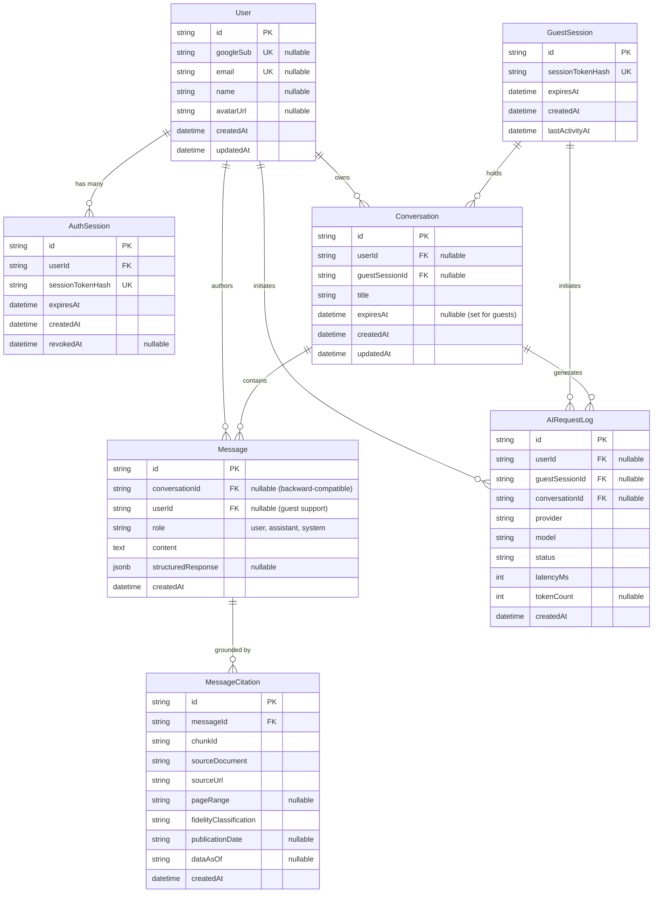

# Nyaya Sahayak — Authentication Architecture & Data Model Specification

**Phase:** Phase 4A — Guest-First Authentication & Database Foundation  
**Status:** Approved Architecture & Reviewed Schema  
**Target Migration:** `prisma/migrations/20261110000000_add_guest_and_auth_schema/migration.sql`

---

## 1. Architectural Principles & Product Decisions

1. **Guest-First Accessibility:**
   Citizens must be able to ask legal questions and access Department of Justice services without mandatory authentication. Frictionless public access is essential for legal literacy and accessibility.
2. **Ephemeral Guest Lifecycles:**
   Guest conversations are stored with a Time-To-Live (`expiresAt`). Guest sessions automatically expire after inactivity or session window elapses.
3. **Optional Google Sign-In for Persistent History:**
   Google OAuth 2.0 / OpenID Connect (OIDC) is provided as an optional enhancement. Signing in allows users to save, review, and search conversation threads across multiple devices.
4. **Guest-to-Authenticated Thread Migration:**
   When a guest signs in during an ongoing conversation, that active guest conversation and its associated messages are atomically linked to the newly authenticated `User` account, removing the expiration TTL.
5. **Strict Credential & Gateway Segregation:**
   - **Express Gateway (Port 3000):** Acts as the sole public gateway. It terminates client connections, verifies Google OAuth tokens, manages session cookies, and handles rate limiting.
   - **FastAPI AI Service (Port 8000):** Private, internal microservice. It manages vector retrieval, prompt assembly, and calls the Google Gemini API using a backend-managed server environment key (`GEMINI_API_KEY`). Client OAuth tokens are never forwarded to Gemini.

---

## 2. Entity Relationship Model (ERD)



---

## 3. Database Schema Detailed Specification

### 3.1 `User`
Stores persistent user identities, either created through Google OAuth Sign-In or retained from historical legacy sessions.

| Column | Type | Constraints | Description |
| :--- | :--- | :--- | :--- |
| `id` | `TEXT` | `PRIMARY KEY`, UUID | Unique user identifier. |
| `googleSub` | `TEXT` | `UNIQUE`, `NULLABLE` | Google Subject Identifier (`sub`) from OIDC token. |
| `email` | `TEXT` | `UNIQUE`, `NULLABLE` | User's verified Google email address. |
| `name` | `TEXT` | `NULLABLE` | Display name provided by Google profile. |
| `avatarUrl` | `TEXT` | `NULLABLE` | Profile avatar image URL. |
| `createdAt` | `TIMESTAMP(3)` | `DEFAULT CURRENT_TIMESTAMP` | Account creation timestamp. |
| `updatedAt` | `TIMESTAMP(3)` | `DEFAULT CURRENT_TIMESTAMP` | Account profile update timestamp. |

### 3.2 `AuthSession`
Stateful, secure session tracking for authenticated Google users.

| Column | Type | Constraints | Description |
| :--- | :--- | :--- | :--- |
| `id` | `TEXT` | `PRIMARY KEY`, UUID | Unique session identifier. |
| `userId` | `TEXT` | `FOREIGN KEY (User.id)` ON DELETE CASCADE | Associated authenticated user. |
| `sessionTokenHash` | `TEXT` | `UNIQUE`, `INDEX` | SHA-256 digest of the opaque session token cookie. |
| `expiresAt` | `TIMESTAMP(3)` | `INDEX` | Absolute expiration date (e.g., 30 days). |
| `createdAt` | `TIMESTAMP(3)` | `DEFAULT CURRENT_TIMESTAMP` | Session issuance timestamp. |
| `revokedAt` | `TIMESTAMP(3)` | `NULLABLE` | Explicit logout or administrative revocation timestamp. |

### 3.3 `GuestSession`
Ephemeral session tracking for unauthenticated visitors.

| Column | Type | Constraints | Description |
| :--- | :--- | :--- | :--- |
| `id` | `TEXT` | `PRIMARY KEY`, UUID | Unique guest session identifier. |
| `sessionTokenHash` | `TEXT` | `UNIQUE`, `INDEX` | SHA-256 digest of the guest cookie token. |
| `expiresAt` | `TIMESTAMP(3)` | `INDEX` | Expiration timestamp (e.g., 24 hours of inactivity). |
| `createdAt` | `TIMESTAMP(3)` | `DEFAULT CURRENT_TIMESTAMP` | First visit timestamp. |
| `lastActivityAt` | `TIMESTAMP(3)` | `DEFAULT CURRENT_TIMESTAMP` | Sliding window activity timestamp. |

### 3.4 `Conversation`
Decouples inquiry threads from individual users, enabling both authenticated and guest threads.

| Column | Type | Constraints | Description |
| :--- | :--- | :--- | :--- |
| `id` | `TEXT` | `PRIMARY KEY`, UUID | Unique conversation thread identifier. |
| `userId` | `TEXT` | `NULLABLE`, `FOREIGN KEY (User.id)` | Set when conversation is owned by an authenticated user. |
| `guestSessionId` | `TEXT` | `NULLABLE`, `FOREIGN KEY (GuestSession.id)` | Set when conversation is an ephemeral guest thread. |
| `title` | `TEXT` | `DEFAULT 'New Inquiry'` | Auto-generated or user-assigned thread title. |
| `expiresAt` | `TIMESTAMP(3)` | `NULLABLE`, `INDEX` | Set for guest threads to enable automated pruning. |
| `createdAt` | `TIMESTAMP(3)` | `DEFAULT CURRENT_TIMESTAMP` | Thread creation timestamp. |
| `updatedAt` | `TIMESTAMP(3)` | `DEFAULT CURRENT_TIMESTAMP`, `INDEX` | Last message timestamp. |

#### Ownership Integrity (Exclusive Ownership)
To ensure strict security and prevent ambiguous or orphaned conversations, each conversation must have **exactly one owner**:
1. **Database-Level CHECK Constraint (`Conversation_owner_check`):**
   ```sql
   ALTER TABLE "Conversation" ADD CONSTRAINT "Conversation_owner_check" 
       CHECK (
           ("userId" IS NOT NULL AND "guestSessionId" IS NULL) OR 
           ("userId" IS NULL AND "guestSessionId" IS NOT NULL)
       );
   ```
2. **Application-Level Enforcement (Express Gateway):**
   - In incoming requests, the Express middleware determines the caller context (authenticated session via `nyaya_session` cookie or guest session via `nyaya_guest` cookie).
   - If both or neither are resolved, the gateway rejects the request with `400 Bad Request` before calling Prisma.
   - When creating a conversation, either `userId` or `guestSessionId` is populated—never both, never neither.
   - During guest-to-authenticated migration, the transfer is executed within an atomic Prisma transaction (`prisma.$transaction`) setting `userId` and clearing `guestSessionId` simultaneously.
| `createdAt` | `TIMESTAMP(3)` | `DEFAULT CURRENT_TIMESTAMP` | Thread creation timestamp. |
| `updatedAt` | `TIMESTAMP(3)` | `DEFAULT CURRENT_TIMESTAMP`, `INDEX` | Last message timestamp. |

### 3.5 `Message`
Individual user queries and AI-generated assistant replies.

| Column | Type | Constraints | Description |
| :--- | :--- | :--- | :--- |
| `id` | `TEXT` | `PRIMARY KEY`, UUID | Unique message identifier. |
| `conversationId` | `TEXT` | `NULLABLE`, `FOREIGN KEY (Conversation.id)` | Nullable for backward compatibility with initial legacy rows. |
| `userId` | `TEXT` | `NULLABLE`, `FOREIGN KEY (User.id)` | Made nullable to allow guest messages without user records. |
| `role` | `TEXT` | `NOT NULL` | `"user"`, `"assistant"`, or `"system"`. |
| `content` | `TEXT` | `NOT NULL` | Raw Markdown or textual content of the message. |
| `structuredResponse` | `JSONB` | `NULLABLE` | Structured response payload (`summary`, `steps`, `authorities`). |
| `createdAt` | `TIMESTAMP(3)` | `DEFAULT CURRENT_TIMESTAMP`, `INDEX` | Message timestamp. |

### 3.6 `MessageCitation`
Verifiable legal citations linked directly to knowledge base chunks.

| Column | Type | Constraints | Description |
| :--- | :--- | :--- | :--- |
| `id` | `TEXT` | `PRIMARY KEY`, UUID | Unique citation identifier. |
| `messageId` | `TEXT` | `FOREIGN KEY (Message.id)` ON DELETE CASCADE | Associated assistant message. |
| `chunkId` | `TEXT` | `NOT NULL`, `INDEX` | Chunk identifier (e.g. `DOJ_STAT_RULE_LIVESTREAM_R005`). |
| `sourceDocument` | `TEXT` | `NOT NULL` | Official source document title. |
| `sourceUrl` | `TEXT` | `NOT NULL` | Verified government URL. |
| `pageRange` | `TEXT` | `NULLABLE` | Page reference in official gazette / publication. |
| `fidelityClassification` | `TEXT` | `DEFAULT 'verbatim'` | `verbatim`, `normalized`, or `structured_from_source`. |
| `publicationDate` | `TEXT` | `NULLABLE` | Official publication date. |
| `dataAsOf` | `TEXT` | `NULLABLE` | Data as-of date for statistical records. |
| `createdAt` | `TIMESTAMP(3)` | `DEFAULT CURRENT_TIMESTAMP` | Creation timestamp. |

### 3.7 `AIRequestLog`
Privacy-preserving operational logging for AI model latency, quota, and reliability.

| Column | Type | Constraints | Description |
| :--- | :--- | :--- | :--- |
| `id` | `TEXT` | `PRIMARY KEY`, UUID | Unique log identifier. |
| `userId` | `TEXT` | `NULLABLE`, `FOREIGN KEY (User.id)` ON DELETE SET NULL | Requesting user (if authenticated). |
| `guestSessionId` | `TEXT` | `NULLABLE`, `FOREIGN KEY (GuestSession.id)` ON DELETE SET NULL | Requesting guest session (if unauthenticated). |
| `conversationId` | `TEXT` | `NULLABLE`, `FOREIGN KEY (Conversation.id)` ON DELETE SET NULL | Associated conversation. |
| `provider` | `TEXT` | `NOT NULL` | AI Provider (e.g., `"gemini"`). |
| `model` | `TEXT` | `NOT NULL` | Model name (e.g., `"gemini-2.5-flash"`). |
| `status` | `TEXT` | `NOT NULL` | Response status (`"success"`, `"error"`). |
| `latencyMs` | `INTEGER` | `NOT NULL` | End-to-end AI latency in milliseconds. |
| `tokenCount` | `INTEGER` | `NULLABLE` | Estimated total token count. |
| `createdAt` | `TIMESTAMP(3)` | `DEFAULT CURRENT_TIMESTAMP`, `INDEX` | Request timestamp. |

---

## 4. Authentication Flow & Session Management

```mermaid
sequenceDiagram
    autonumber
    actor Citizen as Citizen / User
    participant Browser as Web Browser
    participant Express as Express Gateway (:3000)
    participant Google as Google Identity Services
    participant DB as PostgreSQL Database
    participant AI as FastAPI AI Service (:8000)

    Note over Citizen,Browser: 1. Guest Access (Default)
    Citizen->>Browser: Open Nyaya Sahayak
    Browser->>Express: GET / (No auth cookies)
    Express-->>Browser: Set-Cookie: nyaya_guest=<token>; HttpOnly; SameSite=Lax
    Express->>DB: INSERT INTO GuestSession (sessionTokenHash, expiresAt)
    Citizen->>Browser: Ask question: "How to apply for e-filing?"
    Browser->>Express: POST /api/chat (Cookie: nyaya_guest)
    Express->>DB: Find/Create Conversation(guestSessionId)
    Express->>AI: POST /api/v1/chat {message, conversationId}
    AI-->>Express: Response with Grounded Citations
    Express->>DB: Save Message + Citations
    Express-->>Browser: Stream/Return Answer with Citations

    Note over Citizen,Google: 2. Optional Google Sign-In
    Citizen->>Browser: Click "Sign in with Google"
    Browser->>Google: Prompt Google One Tap / Sign-In Dialog
    Google-->>Browser: Credential Response (ID Token / JWT)
    Browser->>Express: POST /api/auth/google/callback {idToken}
    Express->>Google: Verify ID Token (OAuth2Client.verifyIdToken)
    Google-->>Express: Token Payload {sub, email, name, picture}
    Express->>DB: Upsert User by googleSub
    Express->>DB: INSERT INTO AuthSession (userId, sessionTokenHash, expiresAt)
    
    Note over Express,DB: 3. Guest Conversation Migration
    opt Active Guest Thread Exists
        Express->>DB: UPDATE Conversation SET userId = user.id, guestSessionId = NULL, expiresAt = NULL WHERE guestSessionId = guest.id
        Express->>DB: UPDATE Message SET userId = user.id WHERE conversationId = activeConversation.id
    end
    Express-->>Browser: Set-Cookie: nyaya_session=<token>; Clear-Cookie: nyaya_guest; 200 OK
```

---

## 5. Migration Safety & Compatibility Audit

The migration script `20261110000000_add_guest_and_auth_schema/migration.sql` was verified using the official Prisma CLI (`prisma validate` and `prisma migrate diff`) against the existing migration history:

| Safety Criterion | Audit Result | Details |
| :--- | :--- | :--- |
| **Destructive Commands (`DROP TABLE`)** | **0 (Zero)** | No existing tables are dropped. |
| **Destructive Columns (`DROP COLUMN`)** | **0 (Zero)** | No existing columns are removed. |
| **Existing Data Preservation** | **100% Preserved** | Existing `User` and `Message` rows remain valid and accessible. |
| **Nullable Column Transitions** | **Safe** | `Message.userId` changed from `NOT NULL` to nullable via `ALTER COLUMN "userId" DROP NOT NULL;`, allowing guest messages while preserving all historical foreign key relationships. |
| **Conversation Ownership** | **Enforced** | `Conversation_owner_check` CHECK constraint guarantees mutual exclusivity of `userId` and `guestSessionId`. |
| **Prisma CLI Validation** | **Passed** | Schema validated successfully with Prisma CLI 7.10.1 (`prisma validate`). |
| **Prisma Schema Formatting** | **Passed** | Schema formatted with canonical PSL conventions (`prisma format`). |

### 5.1 Legacy Message Compatibility & Backfill Strategy
- **Historical Records:** In the original `20261109165718_init` schema, messages were associated directly with `User` via `userId` without a `Conversation` model.
- **Zero Loss Guarantee:** All existing messages retain their valid `userId` foreign key. Their `conversationId` remains `NULL`.
- **Query Compatibility:** Historical messages remain queryable via `/chatHistory/:userId`.
- **Optional Future Backfill:** A lightweight data migration script can cluster pre-existing user messages into synthetic `Conversation` rows (`title = "Historical Session"`) if unified timeline grouping is desired in the future. No data is lost or altered.

---

## 6. Implementation Checklist & Phase Boundaries

- [x] Phase 4A: Database Schema Design & Migration SQL prepared.
- [x] Phase 4A.1: Prisma CLI restored (7.10.1) and schema validated.
- [x] Phase 4A.1: Canonical migration diff generated and ownership CHECK constraint applied.
- [x] Phase 4A.1: Architecture, legacy compatibility, and data model documentation updated.
- [ ] Phase 4B: Express Gateway Google Auth & Session Middleware (pending approval to execute migration).
- [ ] Phase 4C: Gemini 2.5 Integration in `ai-service/app/services/generator.py`.
- [ ] Phase 4D: Frontend UI Integration for Guest vs Authenticated User Flows.

