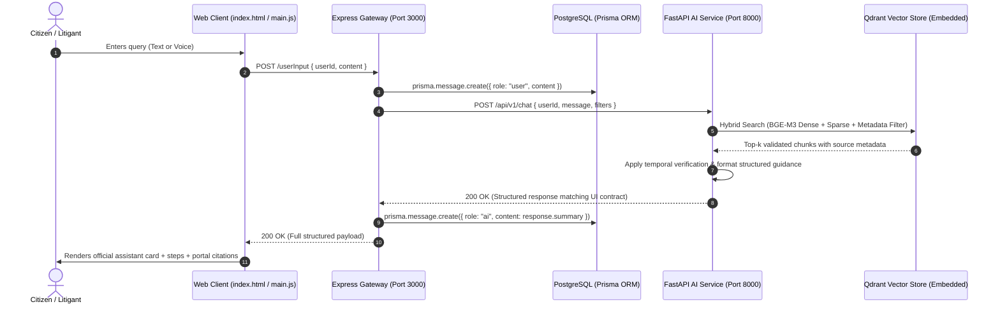

# Nyaya Sahayak (न्याय सहायक) — System Integration Assessment & AI Service Architecture

## 1. Executive Summary

This document outlines the architectural assessment and technical design for integrating the **Nyaya Sahayak** AI Service into the existing government virtual assistant application.

The project integrates three modular layers:
1. **Presentation Layer**: Client-side single page interface (`index.html`, `js/`, `css/`).
2. **Application Gateway Layer**: Node.js & Express server with PostgreSQL/Prisma persistence (`server.js`, `src/`, `prisma/`).
3. **AI & Knowledge Retrieval Layer**: Dedicated Python FastAPI service (`ai-service/`) utilizing dense/sparse vector search, metadata filtering, and authoritative Department of Justice (DoJ) knowledge chunks.

---

## 2. Existing Repository Assessment

### 2.1 Frontend Presentation Layer
- **Core Files**: `index.html`, `js/main.js`, `js/chatbot.js`, `js/interactions.js`, `css/`
- **Rendering Mechanism**: 
  - The UI currently renders response cards via `renderAssistantResponse(data)` in `js/main.js`.
  - It relies on a specific JSON response structure:
    - `summary`: Primary legal/administrative answer (HTML/text).
    - `steps`: Ordered list of procedural guidance steps.
    - `important`: Critical statutory disclaimer, caveat, or notice.
    - `portal`: Official government portal metadata (`{ title, url, domain }`).
    - `source`: Official attribution statement.
    - `followUps`: Array of contextual suggested query strings.
- **Current State**: Operates as a mock assistant via client-side keyword matching against `CHATBOT_KNOWLEDGE_BASE` in `js/chatbot.js`. It does not yet issue asynchronous `fetch()` requests to the Express backend.

### 2.2 Application Gateway & Database Layer
- **Core Files**: `server.js`, `src/app.js`, `src/routes/`, `prisma/schema.prisma`
- **Database**: PostgreSQL managed via Prisma Client (`@prisma/client` v7.10.1).
- **Existing Routes**:
  - `GET /`: Health check route returning `"Health Ok!"`.
  - `POST /userInput`: Ingests `{ userId, content }`, creates/validates user record, writes user message to PostgreSQL (`role: "user"`), and returns stored message metadata.
  - `GET /chatHistory` & `GET /chatHistory/:userId`: Fetches user conversation records.
- **Prisma Schema**:
  - `User`: Unique UUID identifier, timestamps, and relational link to `Message[]`.
  - `Message`: UUID, `userId`, `role` (`"user"` or `"ai"`), text `content`, and creation timestamp.
- **Integration Role**: Serves as the central security and orchestration gateway. The browser communicates exclusively with this Express gateway, which validates tokens/sessions, logs interactions, queries the internal Python AI service, saves the generated reply to PostgreSQL, and returns the structured payload to the frontend.

---

## 3. End-to-End System Communication Flow

---

## 4. Phase 3 Architecture: Embeddings & Vector Retrieval

### 4.1 Embedding Model Evaluation: `BAAI/bge-m3`
- **Model**: `BAAI/bge-m3` (FlagEmbedding, Beijing Academy of Artificial Intelligence).
- **Key Capabilities**:
  1. **Multilingual Supremacy**: Native pre-training on 100+ languages, providing high semantic accuracy across English and Indian regional languages (Hindi, Marathi, Tamil, Bengali, Telugu).
  2. **Unified Hybrid Representation**: Generates 1024-dimensional dense vectors alongside lexical sparse weights (learned BM25-style term importance), enabling precision keyword matching for legal acts alongside semantic search.
  3. **8,192 Token Context Window**: Easily indexes full statutory model rules (e.g., Live Streaming Rule 5, Model VC Rules) without truncation.
- **Resource Footprint**:
  - Model weights: ~2.2 GB (FP32) or ~1.1 GB (FP16 / quantized).
  - Supported runtimes: PyTorch with Apple Silicon `mps`, CUDA, or modern CPU.

### 4.2 Vector Database Evaluation: Qdrant vs. ChromaDB

| Feature | Qdrant (Embedded Local Mode) | ChromaDB (Local Persistent Mode) |
| :--- | :--- | :--- |
| **Execution Architecture** | In-process Python (`path="./qdrant_storage"`) | In-process Python (`path="./chroma_db"`) |
| **Docker Requirement** | **None** in embedded mode | **None** in local mode |
| **Hybrid Search Support** | **Native Dense + Sparse vectors** in one index | Dense only (sparse requires manual BM25) |
| **Payload Filtering** | Full payload index (dates, topics, fidelity) | Basic metadata dict filtering |
| **Production Readiness** | Direct migration to standalone server | Suited primarily for local dev |
| **Package Dependency** | `qdrant-client` | `chromadb` |

**Design Decision**:
- **Primary Engine**: **Qdrant (Embedded Mode)**. Provides native hybrid retrieval (dense + lexical sparse from BGE-M3) with zero external daemon or Docker requirements.
- **Secondary / Fallback Engine**: **ChromaDB**. Clean fallback for purely dense search workflows.

---

## 5. Knowledge Base Files & Workspace Segregation

### 5.1 Files Copied into `ai-service/data/knowledge_base/`
The following validated files have been migrated into the active service workspace:

1. `rag_chunks.jsonl`: 229 validated, audited RAG chunks (224,450 tokens) with complete metadata schemas.
2. `rag_chunks.json`: Complete JSON array representation for programmatic inspection.
3. `sample_chunks.json`: Representative benchmark chunks across the 8 DoJ domains.
4. `master_metadata_index.json`: Master metadata index covering all 17 PDFs and 16 JSON datasets.
5. `content_classification.json`: Canonical topic taxonomy and classification mapping.
6. `docs/CHUNKING_SPECIFICATION.md`: Specification of chunking rules, token windows, and fidelity standards.

### 5.2 Files Maintained Outside Version Control (`.gitignore`)
The repository's `.gitignore` has been hardened to prevent repository bloat and credential leakage:
- **Virtual Environments**: `.venv/`, `venv/`, `env/`
- **Model Caches**: `.cache/`, `.tiktoken_cache/`, `models/`, `huggingface/`
- **Vector Storage**: `ai-service/qdrant_storage/`, `ai-service/chroma_db/`, `*.sqlite3`
- **Secrets & Configuration**: `.env`, `.env.*`
- **Raw PDFs & OCR Artifacts**: Kept strictly in external local storage outside this repository, avoiding duplication of 777 pages of raw binary files in Git.

---

## 6. Implementation Roadmap

1. **Step 1 — Workspace & Baseline Configuration** *(Completed)*:
   - Created `ai-service/` directory structure.
   - Initialized `.gitignore`, `.env.example`, and `requirements.txt`.
   - Seeded `ai-service/data/knowledge_base/` with validated chunks and metadata.
2. **Step 2 — Vector Database & Indexing Pipeline** *(Pending Approval)*:
   - Implement `ai-service/app/services/embedder.py` with BGE-M3 loader.
   - Implement `ai-service/app/services/vector_store.py` with Qdrant embedded engine.
   - Implement `ai-service/scripts/build_vector_index.py` to index the 229 chunks with full payload metadata.
3. **Step 3 — Retrieval & Response Synthesis Engine** *(Pending Approval)*:
   - Implement `retriever.py` with temporal and domain filtering.
   - Implement `generator.py` producing verified, citation-backed JSON responses.
4. **Step 4 — FastAPI Endpoint Delivery** *(Pending Approval)*:
   - Expose `GET /api/v1/health`, `POST /api/v1/retrieve`, and `POST /api/v1/chat`.
   - Add automated test suite in `ai-service/tests/`.

