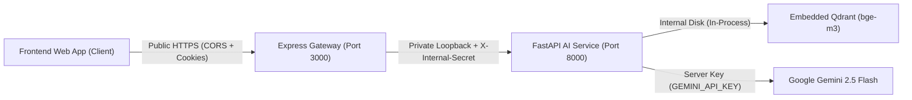

# Nyaya Sahayak — FastAPI Integration Contract & Gateway Specification

**Gateway Component:** Express Application Gateway (Port 3000)  
**Microservice Component:** Python AI Microservice (FastAPI Port 8000)  
**Protocol:** Internal HTTP / JSON  
**Target Endpoint:** `POST http://127.0.0.1:8000/api/v1/chat`  

---

## 1. Network & Security Topology



### Security Directives:
1. **Never Expose Internal AI Endpoints:** The browser only ever talks to Express (`/api/chat`). FastAPI endpoints (`/api/v1/*`) are bound to internal loopback (`127.0.0.1`) and never reachable from the public internet.
2. **Internal Gateway Authentication:** Every request sent from Express to FastAPI passes the `X-Internal-Secret` header configured via `INTERNAL_AI_SECRET`.
3. **No Direct Google Gemini Keys in Express:** Express never holds `GEMINI_API_KEY`. Gemini API communication is encapsulated solely inside FastAPI.
4. **Correlation Tracking:** Express generates a unique UUID `X-Request-Id` and passes it to FastAPI for unified log correlation.

---

## 2. Request Contract (`POST /api/v1/chat`)

### Headers
```http
POST /api/v1/chat HTTP/1.1
Host: 127.0.0.1:8000
Content-Type: application/json
Accept: application/json
X-Internal-Secret: <INTERNAL_AI_SECRET>
X-Request-Id: 95b9bea5-a5da-439d-b599-d8b2184b8848
```

### Request Payload Schema
```json
{
  "userId": "string (optional - UUID of User or GuestSession)",
  "conversationId": "string (optional - UUID of Conversation)",
  "message": "string (mandatory - Litigant question, 1-4000 chars)",
  "language": "string (optional - ISO language code, default: 'en')",
  "topic": "string (optional - Canonical DoJ domain filter)",
  "top_k": "integer (optional - Supporting chunks, default: 3, max: 10)"
}
```

---

## 3. Response Contract (`200 OK`)

The Express backend strictly preserves the AI service's response semantics without alteration:

```json
{
  "userId": "usr-123",
  "conversationId": "conv-456",
  "summary": "Live streaming of court proceedings is permitted under Rule 5.1 of the Model Rules...",
  "steps": [
    "Matrimonial disputes and sexual offenses are strictly excluded under Rule 5.1(i)-(ii).",
    "A statutory ten-minute delay buffer is enforced under Rule 8.3.",
    "Unauthorized capture or recording is punishable under Rule 9.2."
  ],
  "important": "Point-in-Time Statistic: This metric reflects official data as of 2026-11-08.",
  "portal": {
    "title": "eCourts Services Portal",
    "url": "https://services.ecourts.gov.in",
    "domain": "services.ecourts.gov.in"
  },
  "source": "Model Rules for Live Streaming and Recording of Court Proceedings — Ministry of Law & Justice",
  "followUps": [
    "What matters are excluded from live streaming under Rule 5?",
    "What are the penalties for unauthorized recording under Rule 9?"
  ],
  "citations": [
    {
      "chunk_id": "DOJ_STAT_RULE_LIVESTREAM_R005",
      "document": "Model Rules for Live Streaming and Recording of Court Proceedings",
      "page_range": "3-5",
      "source_url": "https://doj.gov.in/rules-livestreaming",
      "fidelity_classification": "verbatim",
      "data_as_of": "2021-06-01"
    }
  ],
  "audit": {
    "information_type": "static",
    "publication_date": "2021-06-01",
    "derived_analysis": null,
    "audit_notes": null
  }
}
```

---

## 4. Failure & Degraded State Semantics

The Express backend strictly adheres to safe failure boundaries:
- **FastAPI Timeout (>15 seconds):** Express aborts the request, logs the event in `AIRequestLog`, and returns `504 Gateway Timeout` with code `AI_SERVICE_TIMEOUT`.
- **FastAPI 5xx or Connection Refused:** Express catches the error and returns `503 Service Unavailable` with code `AI_SERVICE_UNAVAILABLE`.
- **Zero Hallucination Rule:** **Express NEVER invents legal answers or returns a fabricated 200 response when the AI service is offline.**
